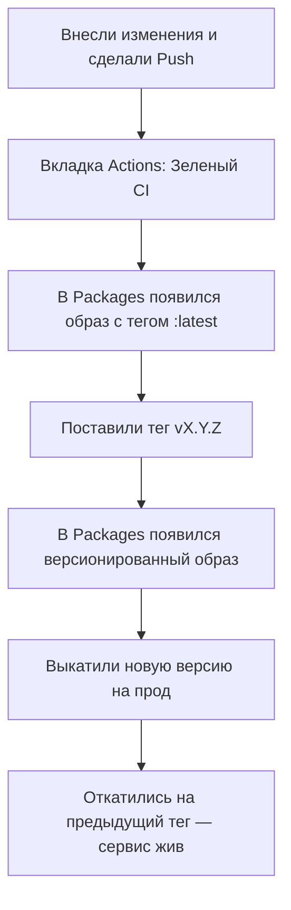

# 🚀 Требования к Капстоун-проекту

Репозиторий оформлен в соответствии со стандартами промышленной разработки. Входной точкой для ознакомления является `README.md`, а для экстренных ситуаций подготовлен `RUNBOOK.md`.

---

## 📦 Модуль 1. Окружение, Docker и Конфигурация

### Управление зависимостями
* [ ] **Менеджер пакетов `uv`**: в корне проекта присутствуют файлы конфигурации `pyproject.toml` и `uv.lock`.
* [ ] **Версия Python**: строго зафиксирована в файле `.python-version`.

### Docker и Контейнеризация
* [ ] **Dockerfile**: 
  * Оптимизирован кэш сборки — установка зависимостей происходит строго **до** копирования основного исходного кода.
  * Сервер запускается с флагом `--host 0.0.0.0` для доступности извне контейнера.
* [ ] **.dockerignore**: исключены лишние файлы и директории (обязательно добавлены `.env`, `.git`, `.venv`).

### Оркестрация (Docker Compose)
* [ ] **Архитектура**: в `compose.yaml` описаны два сервиса — основной веб-сервис и база данных **PostgreSQL**.
* [ ] **Связанность**: база данных доступна для приложения по имени соответствующего сервиса.
* [ ] **Надежность**:
  * Настроена проверка состояния базы данных (`healthcheck`).
  * Для основного сервиса задана запускная зависимость `depends_on` с условием `service_healthy`.
  * Данные базы вынесены в постоянное хранилище (`volume`).

### Конфигурация и Безопасность
* [ ] **Валидация**: конфигурация приложения полностью собрана и валидируется через `pydantic-settings`.
* [ ] **Управление секретами**:
  * Локальные секреты хранятся в `.env` (файл строго добавлен в `.gitignore`).
  * В репозиторий выложен публичный шаблон `.env.example`.
  * В файле `compose.yaml` пароли и приватные ключи прокидываются через переменные окружения в формате `${...}`.

---

## 🔄 Модуль 2. CI/CD и Релизы

| Процесс | Триггер | Описание / Инструменты |
| :--- | :--- | :--- |
| **CI (Интеграция)** | `push`, `pull_request` | Автоматический запуск линтера **Ruff** и прогон тестов через **pytest**. |
| **CD (Доставка)** | Успешный CI в ветке `main` | Сборка и публикация Docker-образа в **ghcr.io** (блок `needs: check`). |
| **Релиз** | Git-тег вида `vX.Y.Z` | Сборка версионированного образа по **SemVer**. Ведется файл истории изменений `CHANGELOG.md`. |

---

## 🛡️ Модуль 3. Эксплуатация и Отказоустойчивость

* [ ] **Демонстрация отката**: готовность показать процесс деплоя новой версии по тегу и бесшовный возврат на предыдущую стабильную версию.
* [ ] **Обратная совместимость**: если приложение использует схему данных (БД), любые изменения структуры обратно совместимы. 
  > 💡 *Необходимо уметь аргументированно объяснить архитектурную причину обратной совместимости во время защиты.*
* [ ] **Документация**:
  * `README.md` — «входная дверь» проекта с описанием запуска.
  * `RUNBOOK.md` — аварийная инструкция на случай сбоев.

---

## 🎯 Демонстрация и Защита

Защита капстоуна проходит в формате **живой демонстрации истории релиза** по шагам на вашем репозитории:

### Чек-лист для финального ответа на защите:
1. Показать `README.md` и `RUNBOOK.md`.
2. Аргументировать одно ключевое архитектурное решение на выбор:
   * Почему была выбрана именно такая стратегия выката?
   * За счет чего миграция базы данных осталась обратно совместимой?